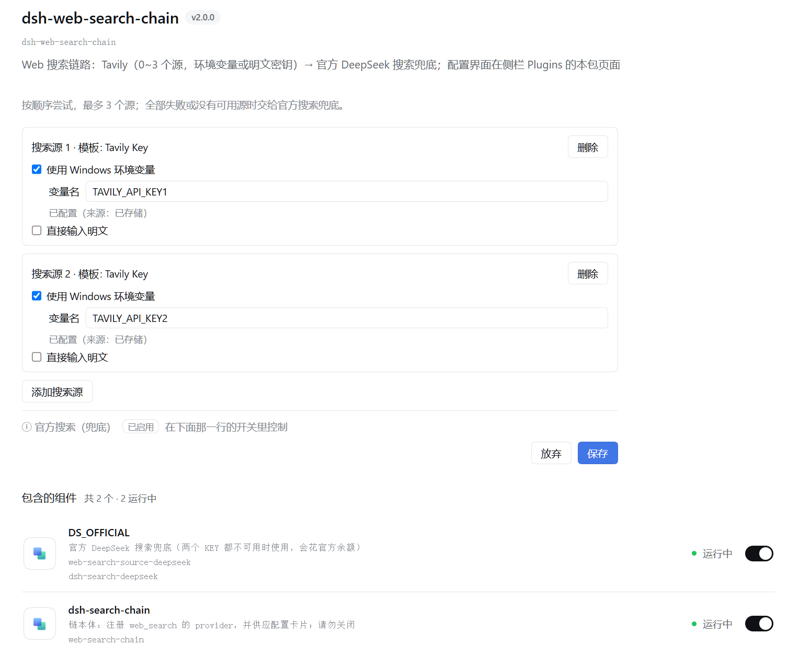

# dsh-websearch-tavily-keys-select

[中文](#中文) ｜ [English](#english)

给 DeepSeek Harness 的 `web_search` 加一条**多源链路**：按顺序尝试最多 **3 个源**，全部失败或一个都没配时交给**官方 DeepSeek 搜索**兜底。
源有三种模板：**腾讯元宝搜索**（腾讯云 `SearchPro`，SecretId + SecretKey 签名，带额度闸门）、**DeepSeek 搜索 API**（REST，5 元/千次）和 **Tavily**（一个 key）。推荐腿序：元宝 → Tavily → DS 搜索 API。
密钥可取 Windows 环境变量，也可直接输入明文。配置卡片就在**侧栏 Plugins → bundle 包页**上。

> **改配置不用重启 DSH**：链路每次搜索都重读配置文档。



> ☝️ 真实截图（2026-09-29，早于元宝搜索通道）：每个源二选一 —— **使用 Windows 环境变量**（填变量名，如 `TAVILY_API_KEY1`）或**直接输入明文**；
> 状态行会显示 `已配置（来源：已存储 / 环境变量 / 未配置）`。页面下半部分「包含的组件」列出两个行包
> （`DS_OFFICIAL` 官方兜底 / `dsh-search-chain` 链本体）与各自的**运行开关**。

---

## 中文

### 它解决什么

- **省钱 + 不超额**：元宝搜索有自己的免费额度（**日常 2000 次/自然月/UIN**），超额按量计费且**贵**（标准版 20 元/千次，是 DeepSeek 搜索 API 的约 4 倍）；
  官方 DeepSeek 搜索**会花官方余额**。链路因此在元宝源上带**本地月度额度闸门**：到点就跳过它，不花超额的钱。
- **多个源轮换**：最多 3 个源按顺序试，某个 key 失效、超时或额度用完会**自动试下一个**，不用手改配置。
- **密钥不进 DSH 的明文**：SecretKey / Tavily key 优先用 **Windows 环境变量**（密钥留在系统里）；
  只有 **SecretId** 明文存在配置文档里（它按腾讯云的定义是"类比用户名"的标识，且必须方便更换）。
- **可换**：SecretId 在卡片上直接改；SecretKey 换环境变量的值（或改成明文模式）；额度/保留余量也在卡片上改。

### 元宝搜索（腾讯云）

| 事项 | 值 |
|---|---|
| 接口 | `SearchPro`，Version `2025-05-08`，域名 `wsa.tencentcloudapi.com`（就近地域接入） |
| 认证 | 腾讯云 API 3.0 **TC3-HMAC-SHA256** 签名（SecretId + SecretKey）；不用 Region |
| 免费额度 | **2000 次 / 自然月 / UIN**（全版本通用） |
| 限时活动 | 凭邀请码 **6000 次 / 自然月 / UIN**，**2026-10-10 ~ 2026-11-30（北京时间）**，**结束后恢复 2000** |
| 超额计费 | 后付费、按日结算：极速版 14 / **标准版 20** / 旗舰版 26 元每千次调用（调用失败不计费） |
| 参数支持 | 标准版/旗舰版支持 `Mode`（0 公开网页 / 1 权威垂直 / 2 混合）、`Cnt`（10~50）、`Industry`、`Freshness`、`Site`、`Deeplinks`；**极速版不支持 `Mode`/`Cnt`** |

#### 怎么查额度（腾讯云没有"查配额"API）

API 概览里**只有 `SearchPro` 一个接口**，没有配额查询接口 ⇒ 剩下四条路，权威性从高到低：

1. **费用中心 → 账单查看**（按量计费的每日调用量，官方明确"实际用量以账单为准"）；
2. **元宝搜索控制台 → 概览 / 我的资源包**：剩余免费额度、资源包消耗；
3. **控制台 → 监控信息**：`request_count`（60s/300s/3600s/86400s 聚合），保留最近 186 天；
4. **本插件的本地账本**：`$DSH_HOME\web-search-chain-usage.json`（按北京时间自然月计数），卡片上直接显示"本月已用 X / Y，还剩 Z"。

> 本地账本只统计**本机这个 DSH 走这条链**的调用；如果同一个 SecretId 还被别的工具用过，账本会偏小 ⇒ 所以默认留了 `reserve` 余量，
> 并且卡片上「本月已用」可以**手动校准**（填成控制台/账单上的数字，保存即生效）。

#### 两类源，两种计量单位

| 源 | 计量单位 | 官方查额度接口 | 卡片上能看到 |
|---|---|---|---|
| 腾讯元宝搜索 | **调用次数**（每次 1） | ❌ 没有（只能看控制台/账单/监控） | 本月已用 X / Y 次、剩余、活动额度 |
| DeepSeek 搜索 API | **调用次数**（5 元/千次，成功才计费） | ❌ 没有 | 本月已用 X 次（不设预算时不封顶） |
| Tavily | **credit**（basic 搜索 1、advanced 2） | ✅ `GET https://api.tavily.com/usage` | 本月已用 X credits；点「查额度」还会显示**上游**的套餐已用/上限（如 `Researcher 1000/1000`），用满会标红 |

> Tavily 的「查额度」是只读动作：不保存配置、不消耗 credit，Key 由宿主代发，界面看不到明文。
> 本地账本的 `credits` 与上游 `plan_usage` 可以互相印证：差值就是"被别的工具用掉的"（或校准误差）。
> 预算（`budget.monthly` / `reserve`）**按各源自己的单位**生效：元宝填 2000 是 2000 次，Tavily 填 1000 是 1000 credits。

#### 怎么控额度（默认就已经在控）

1. **硬闸门**：`budget.monthly`（日常额度）+ `budget.reserve`（保留不用的余量）。可用 = `monthly − reserve`；
   已用 ≥ 可用 ⇒ **这一条源被跳过**（审计日志记 `quota-exhausted`），一个请求都不发。
2. **活动额度带到期日**：`budget.promo = { monthly: 6000, until: '2026-11-30' }` —— 活动期内按 6000 算，
   **过了 2026-11-30（北京时间）自动降回 2000**，不依赖任何人记得去改配置。
3. **默认值就是保守的**：日常 2000、保留 100、活动 6000 至 2026-11-30。
4. **账本写不进去也不会失守**：内存里还有一份计数（取 `max(文件, 内存)`），写盘失败时闸门照常推进。
5. **审计**：每次调用/拦截都有一行 JSON 落 `$DSH_HOME\web-search-chain.log`（`served` / `quota-exhausted` / `failed`），带当时的额度状态。

### 安装

```bash
dsh plugin --profile <你的 profile> add dsh-websearch-tavily-keys-select
```

装完**重启 DSH**（打包版没有「刷新页面」）。它会自动带上两个行包：

| 行包 | 作用 |
|---|---|
| `dsh-search-chain` | **链本体**：注册 `web_search` 的 provider，并供应上面那张配置卡片 |
| `dsh-search-deepseek` | **官方兜底**：其它源全失败/未配置时用官方搜索（**花官方余额**） |

> 这两个行包**不需要单独安装**，也不建议单独装 —— 装错了会少一半功能。

### 怎么配

| 源 | 必填 | 说明 |
|---|---|---|
| 腾讯元宝搜索 | **SecretId** + SecretKey（环境变量名或明文）+ 可选额度 | SecretId 明文存在配置文档里（可随时改）；SecretKey 默认读 `TENCENTCLOUD_SECRET_KEY` |
| DeepSeek 搜索 API | key（环境变量名或明文） | `DEEPSEEK_API_KEY`（5 元/千次，成功才计费） |
| Tavily | key（环境变量名或明文） | `TAVILY_API_KEY1` / `TAVILY_API_KEY2` 之类 |

- **源的顺序 = 尝试顺序**；最多 **4 个**源；每个源失败自动降级到下一个。
- **官方兜底**：页面里 `DS_OFFICIAL` 那个开关。本机 2026-10-22 起**已关掉**（改用 DS 搜索 API 兜底）——关掉就不花官方余额。
- **停用（disable，不是删除）**：每个源行首有「启用」勾选框，取消勾选 ⇒ 该源**留在配置里**但不再参与搜索（密钥、顺序、额度设置都保留，随时可勾回来）。
- **自动停用**：某源**连续 3 次确定性失败**（鉴权失败 / 套餐超限 / 404 这类"不修就一直失败"的错误）后，宿主自动把它摘出链路，卡片上显示原因与「恢复」按钮；超时、429、5xx 属于暂时性失败，**不累计**。
- 保存后**立即生效**（下一次搜索就用新配置），无需重启。
- 环境变量是 DSH **启动时**快照的：新加/改完 `TENCENTCLOUD_SECRET_KEY` 要**重启 DSH** 才生效。

### query 里怎么写「时效」和「站点」

`web_search` 只接受 `{queries}`，没有额外参数字段；但你**不用记参数**——直接在查询里用自然写法，插件会翻译成元宝的真参数：

| 你写的 | 插件实际发 |
|---|---|
| `site:www.gov.cn 人工智能+ 行动意见` | `Site="www.gov.cn"`，并把 `site:` 记号从 Query 里删掉 |
| `site:a.com,b.com 价格` | `Site="a.com,b.com"` |
| `今天/刚刚 …` | `Freshness="d1"` |
| `昨天 …` | `Freshness="d2"` |
| `本周/最近7天 …` / `最近3天 …` | `Freshness="d7"` / `"d3"` |
| `本月 …` / `最近3个月 …` / `今年 …` | `Freshness="m1"` / `"m3"` / `"y1"` |
| `2026年10月21日 …`（显式日期） | 按距今天数折算成 `d2/d7/m1/m3/y1` |

- **为什么必须这样**：元宝把 `site:` 当普通词（实测 `site:github.com` 完全不生效），而 `Freshness` 是独立参数。
- **`最新/latest` 不触发**：这类宽泛词会误伤官网资料页（它们没有日期）；实测 `Latest DeepSeek model release` 不传更稳。
- **实测收益**：问「2026年10月21日 A股 收盘」不传 Freshness 时 10 条全是 **2025 年同日旧闻**；加了 `d2` 后 10/10 是当日新闻。
- **覆盖**：链行配置里写 `yuanbao.freshness` / `yuanbao.site` 会**强制**用配置值（压过自动判定），适合"只想搜某站"的专用实例。
- `Site` 只对自然结果生效（`Mode=1` 的垂直卡片不吃它）；实测黑名单语法 `-host` 返回 **0 条**，暂不支持。

### 配置存在哪 / 怎么排查

| 路径 | 作用 |
|---|---|
| `$DSH_HOME\web-search-chain.json` | **源列表（唯一真源）**，每次搜索重读；损坏或超 64 KB 时按默认值工作 |
| `$DSH_HOME\web-search-chain-usage.json` | **本地额度账本**（按北京时间 `YYYY-MM` 分桶，v2 记 `{calls, credits}`）；坏了按 0 计（保留余量兜底） |
| `$DSH_HOME\web-search-chain-state.json` | **运行时状态**：连续失败计数 + 自动停用标记；与配置分开存，删掉它就等于"全部恢复"（源本身一个都不少） |
| `$DSH_HOME\.credentials.yaml` | **明文密钥**进 DSH 凭据域（`refs` 段，引用名 `WEB_SEARCH_TAVILY_<n>`） |
| `$DSH_HOME\web-search-chain.log` | **审计日志**：哪条源服务了、何时走了官方兜底、何时因额度被跳过 |

### 兼容性与合规

- **实测环境**：DSH 桌面壳 `0.2.x`（Windows）。
- host 半边**零 `@deepseek-ai` 静态 import**（官方兜底那一次是**懒动态 import**，只有真要走兜底时才加载）；TC3 签名自己实现，**零依赖**。
- 客户端半边只 `require` `react` / `react-dom` / `react/jsx-runtime`（基座）；checkbox / input / button / 标签**全部自包含**（官方 practices 禁止 client 半边 require 任何 Harness Client 包）。
- `ModuleLoader` 的 factory id **等于包名**；`apply` 与所有回调**绝不外抛**（client entry 一旦 failed 会撞「每条 client entry 必须 active」的全有全无启动门禁）。
- 包内声明 `dsh.bundle.patch`（官方交付单位；缺它 `install_bundle` 会回滚整次安装）。

### 测试（离线，任意 cwd）

```powershell
node test\run-all.mjs         # 9 个测试文件 / 167 条（含 manifest 11、route 35、core-budget 14、tencent-sign 9）
node test\verify-client.mjs   # 客户端验证台：80/80（含合规守卫、注册 key 动态比对）
node test\make-mutants.mjs    # 变异测试：14/14 必须被杀（含"拆掉额度闸门""月份键改 UTC""签名不做小写""停用的源照样被搜"）
```

> ⚠️ 别用 `node --test`：本机沙箱禁命名管道，runner 会 spawn EPERM 并给出误导性的 `# fail 1`。

---

## English

A **multi-source web-search chain** for DeepSeek Harness: try up to **4 sources** in order, and fall back to the **official DeepSeek search** when every source fails or none is configured.
Three source templates: **Tencent Yuanbao Search** (Tencent Cloud `SearchPro`, SecretId + SecretKey signature, with a local quota gate), **DeepSeek Search API** (REST, 5 CNY/1000) and **Tavily** (a single key). Recommended order: Yuanbao → Tavily → DeepSeek Search API.
Keys come from Windows environment variables or can be typed in as plaintext. The configuration card lives on the bundle's **Plugins** page.

> **No restart needed** to change the configuration — the chain re-reads its config document on every search.

### Yuanbao Search (Tencent Cloud)

| Item | Value |
|---|---|
| API | `SearchPro`, version `2025-05-08`, endpoint `wsa.tencentcloudapi.com` |
| Auth | Tencent Cloud API 3.0 **TC3-HMAC-SHA256** (SecretId + SecretKey) |
| Free quota | **2000 calls / calendar month / UIN** |
| Promotion | **6000 calls / month** with an invite code, **2026-10-10 → 2026-11-30 (Asia/Shanghai)**, then back to 2000 |
| Overage | pay-as-you-go, daily settlement: 14 / **20** / 26 CNY per 1000 calls (lite / **standard** / flagship); failed calls are not billed |

There is **no quota-query API** (the product exposes only `SearchPro`). Authoritative sources, best first:
the **billing console** (daily usage), the Yuanbao Search console (**Overview / My resource packages**), the
**monitoring** page (`request_count`), and this plugin's **local monthly ledger** (`$DSH_HOME\web-search-chain-usage.json`),
which the card shows as “used / quota / remaining” and can be **calibrated** by hand.

Quota is **gated by default**: usable = `monthly − reserve`; once used ≥ usable the source is **skipped** (audit line
`quota-exhausted`, no request sent). The promotion allowance carries an expiry date, so it **drops back to 2000
automatically on 2026-12-01** (Asia/Shanghai) even if nobody edits the config.

### Install / Configure

```bash
dsh plugin --profile <your-profile> add dsh-websearch-tavily-keys-select
```

Restart DSH afterwards. Two row packages come along automatically: **`dsh-search-chain`** (the chain itself + this configuration card) and **`dsh-search-deepseek`** (official fallback — **spends official credit**). Do not install them separately.

- **Source order = try order**, at most **3** sources; a failing/exhausted source falls through to the next.
- The **`DS_OFFICIAL` switch** (on by default) controls the official fallback — turn it off to stop spending official credit.
- Environment variables are snapshotted at DSH start: restart DSH after changing `TENCENTCLOUD_SECRET_KEY`.

| Runtime file | Purpose |
|---|---|
| `$DSH_HOME\web-search-chain.json` | the source list (single source of truth), re-read on every search |
| `$DSH_HOME\web-search-chain-usage.json` | local monthly quota ledger (Asia/Shanghai months) |
| `$DSH_HOME\.credentials.yaml` | plaintext keys, under `refs` as `WEB_SEARCH_TAVILY_<n>` |
| `$DSH_HOME\web-search-chain.log` | audit log: which source served, when the fallback ran, when quota blocked a leg |

### Compliance

Host side has **zero `@deepseek-ai` static imports** (the official fallback is a lazy dynamic import) and the TC3 signer is dependency-free. The client half only requires `react` / `react-dom` / `react/jsx-runtime` and is otherwise self-contained; its `ModuleLoader` factory id equals the package name, and `apply` never throws. The package declares `dsh.bundle.patch`.

### Tests

```powershell
node test\run-all.mjs         # 9 files / 146 tests
node test\verify-client.mjs   # 71/71, including compliance guards
node test\make-mutants.mjs    # 10/10 mutants must be killed
```

---

### License

MIT
